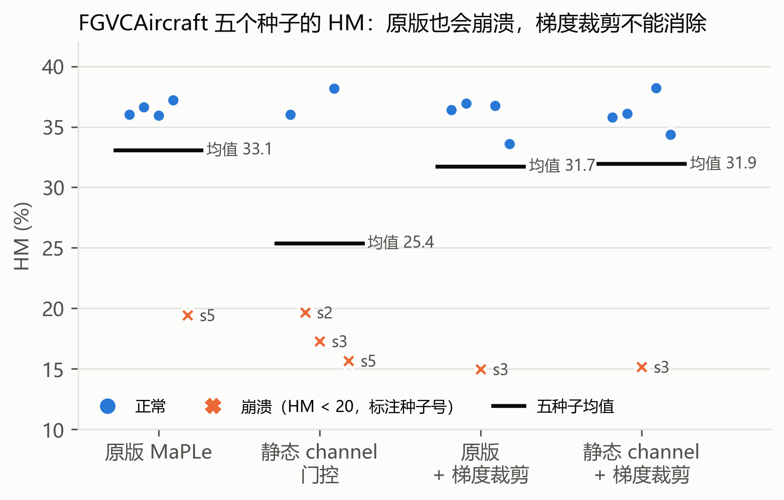
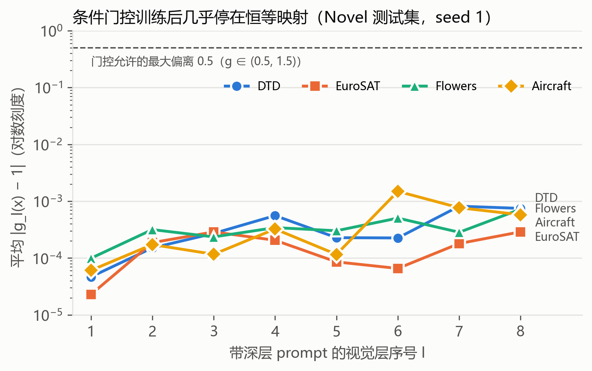

# MaPLe 复现与改进：跨模态门控分析 + 教师可信度加权的知识一致性

深度学习课程项目。复现 [MaPLe](https://github.com/muzairkhattak/multimodal-prompt-learning)（CVPR 2023），
并在其基础上做了两个阶段的改进实验：

1. **第一阶段：跨模态门控。** 在深层"文本 prompt → 视觉 prompt"投影后加可学习门控：静态的 scalar/channel，
   以及依赖输入图像的条件门控（cond_channel）。结论是负结果：静态门控可被投影矩阵吸收、不增加表达能力；
   两类门控训练后都几乎停在恒等映射（偏离 ≤ 1e-3），没有稳定提升。
2. **第二阶段：零样本知识一致性（KC）。** 用冻结的 CLIP 约束 prompt 学习，缓解新类遗忘；并提出按
   零样本教师在训练样本上的可信度 `w_i = p_zs(y_i|x_i)` 加权（`kc_rw`）。它是唯一在六个数据集平均
   Base / Novel / HM 上同时超过原版的变体。

另一个发现：FGVCAircraft 上的训练崩溃**原版 MaPLe 也会发生**（5 个种子中崩 1 个），并不是门控引入的；梯度裁剪也不能消除。

## 主要结果

ViT-B/16、16-shot、5 epochs，原 MaPLe 训练配方；Base-to-Novel，HM 逐种子计算后取 3 个种子（1/2/3）的均值（%）。

| 方法 | Pets | DTD | Caltech | Flowers | EuroSAT | Aircraft | 平均 HM | 平均 Base | 平均 Novel |
|---|---:|---:|---:|---:|---:|---:|---:|---:|---:|
| MaPLe 复现（none） | 96.59 | 66.00 | 96.50 | 83.16 | 81.10 | 36.20 | 76.59 | 82.93 | 71.89 |
| + 静态 channel 门控 | 96.74 | 65.40 | 96.33 | 82.62 | 82.38 | 24.32 | 74.63 | 81.98 | 69.44 |
| + 条件门控 | 96.62 | 67.25 | 96.13 | 82.04 | 80.91 | 35.70 | 76.44 | 82.93 | 71.61 |
| + 固定权重 KC | 96.27 | 69.63 | 96.10 | 84.70 | 73.77 | 36.68 | 76.19 | 82.27 | 71.65 |
| **+ 可信度加权 KC（kc_rw）** | 96.36 | **71.86** | 96.07 | 84.16 | 76.55 | 36.67 | **76.95** | **83.32** | **72.14** |

需要如实说明的几点：

- kc_rw 不是逐数据集普遍提升：DTD +5.86、Flowers +1.00，但 EuroSAT −4.55，Pets、Caltech 小幅下降。
- kc_rw 是在看到固定 KC 的 EuroSAT 测试结果之后提出的（事后设计）；公式只用训练集标签，系数沿用
  PromptSRC 的 25/10/1，没有调参。KC 的基本形式来自 PromptSRC，原创部分只有可信度加权。
- 复现基线与原论文相比，DTD Novel 低约 3.3、EuroSAT Base 低约 2.9，见[复现核对](docs/BASELINE_REPRODUCTION_AUDIT.md)。
- 只做了 11 个数据集中的 6 个，没有做跨数据集迁移和域泛化。

| FGVCAircraft 五种子稳定性 | 条件门控训练后的偏离 |
|---|---|
|  |  |

完整表格、逐种子数据、门控统计和开销见 [docs/RESULTS_V2.md](docs/RESULTS_V2.md)。

## 文档导航

| 文档 | 内容 |
|---|---|
| [docs/MAPLE_PAPER_EXPLAINED.md](docs/MAPLE_PAPER_EXPLAINED.md) | 原论文梳理：问题、创新点、架构、实验与局限 |
| [docs/PAPER_OUTLINE.md](docs/PAPER_OUTLINE.md) | 论文框架与各章写作要点 |
| [docs/RESULTS_V2.md](docs/RESULTS_V2.md) | 第二阶段结果：条件门控、KC、kc_rw、稳定性、门控统计 |
| [docs/EXPERIMENT_PLAN_V2.md](docs/EXPERIMENT_PLAN_V2.md) | 第二阶段预登记（超参在看结果前固定） |
| [docs/BASELINE_REPRODUCTION_AUDIT.md](docs/BASELINE_REPRODUCTION_AUDIT.md) | 复现结果与原论文、作者日志的对照 |
| [docs/PROJECT_NOTES.md](docs/PROJECT_NOTES.md) | 第一阶段：静态门控的原理、实验与结论 |
| [docs/RESULTS_EXPANDED_2026-10-22.md](docs/RESULTS_EXPANDED_2026-10-22.md) | 第一阶段六数据集主比较与冻结投影消融 |
| [docs/DIAGNOSTIC_RESULTS_2026-10-22.md](docs/DIAGNOSTIC_RESULTS_2026-10-22.md) | 第一阶段 Aircraft 崩溃的三组诊断 |
| [docs/WALKTHROUGH.md](docs/WALKTHROUGH.md) | 从零走一遍：代码结构、运行方式 |
| [docs/RELATED_WORK_2026-10-22.md](docs/RELATED_WORK_2026-10-22.md) | 相关工作核查 |
| [docs/results/](docs/results/) | 机器可读的聚合结果（JSON） |

## 代码改动一览

| 配置项（`TRAINER.MAPLE.*`） | 默认 | 说明 | 代码 |
|---|---|---|---|
| `GATE_TYPE` | `none` | `scalar` / `channel`：静态门控；`cond_channel` / `cond_scalar`：由当前层 CLS token 生成的条件门控 | `trainers/maple.py`、`clip/model.py` |
| `GATE_RANK` | 32 | 条件门控瓶颈宽度 | `trainers/maple.py` |
| `KC_TEXT_WEIGHT` / `KC_IMAGE_WEIGHT` / `KC_LOGIT_WEIGHT` | 0 | 零样本一致性损失权重（0 = 原版目标） | `MaPLe._consistency_loss` |
| `KC_REWEIGHT` | `none` | `teacher_conf`：按教师对训练样本真实类的概率加权 | 同上 |
| `GRAD_CLIP` | 0 | 全局梯度范数裁剪（0 = 关闭） | `MaPLe._grad_norm` |

全部默认值都等于原版 MaPLe。新代码下重跑 EuroSAT none，330 个 checkpoint 张量与第一阶段逐位相同。
所有门控的输出层都是零初始化，训练第一步与原版逐位一致。

## 安装与运行

能跑原版 MaPLe 的环境可以直接用（本项目用 PyTorch 2.1.2 + RTX 3090）。全新环境按 [环境说明](docs/ENVIRONMENT.md) 装。
数据和 few-shot 缓存不进 Git，下载方式见 [DATASETS.md](docs/DATASETS.md)。

```bash
git clone https://github.com/Graccce/maple-layer-channel-gating.git
cd maple-layer-channel-gating
python scripts/check_repository.py
python -m unittest discover -s tests -v
```

**第二阶段（推荐入口）**：`run_v2.sh` 训练一个变体并分别评估 Base / Novel，变体由配置覆盖项决定：

```bash
export DATA_ROOT=/absolute/path/to/datasets
KC="TRAINER.MAPLE.KC_TEXT_WEIGHT 25.0 TRAINER.MAPLE.KC_IMAGE_WEIGHT 10.0 TRAINER.MAPLE.KC_LOGIT_WEIGHT 1.0"
# 原版
bash scripts/maple/run_v2.sh "$DATA_ROOT" dtd none 1 my_run formal
# 可信度加权 KC
bash scripts/maple/run_v2.sh "$DATA_ROOT" dtd kc_rw 1 my_run formal $KC TRAINER.MAPLE.KC_REWEIGHT teacher_conf
# 条件门控
bash scripts/maple/run_v2.sh "$DATA_ROOT" dtd cond_channel 1 my_run formal TRAINER.MAPLE.GATE_TYPE cond_channel
```

注意：浮点型配置必须写成 `25.0` 而不是 `25`，否则 yacs 会报类型错误。输出在
`output/v2/STAGE/RUN_ID/DATASET/TAG/seedN/`；为节省磁盘，checkpoint 评估后默认删除，只留 SHA-256（`KEEP_CKPT=1` 保留）。

本项目实际跑过的全部任务都在 [scripts/maple/queues_v2/](scripts/maple/queues_v2/) 里，可以按顺序复现：

```bash
DATA_ROOT=$DATA_ROOT bash scripts/maple/run_queue.sh scripts/maple/queues_v2/01_main.txt
python scripts/maple/summarize_v2.py summary.json /path/to/phase1/output/gating_v1/formal output/v2/formal
python scripts/maple/plot_paper_figures.py   # 由 docs/results 重新生成论文插图
```

条件门控统计：`scripts/maple/export_gate_stats.py`（用法见文件头注释）。

**第一阶段**（静态门控）入口是 `scripts/maple/run_gating.sh`，用法见 [WALKTHROUGH](docs/WALKTHROUGH.md)。

## 来源与许可证

基于官方 MaPLe commit `69bce21ae8eda80ad6187534b2dce09cf6c59e17` 的源码快照，保留 [MIT LICENSE](LICENSE) 和
[原始 README](docs/UPSTREAM_README.md)。完整来源和 fixture 校验见 [UPSTREAM.md](UPSTREAM.md)。
KC 损失形式与系数参考 PromptSRC（Khattak et al., ICCV 2023）。
